# Resultados da execução `20261017-115724`

> Ambiente WSL2: o Linux roda numa VM. O disco é um arquivo virtual do Windows (VHDX), então o "cache frio" esvazia o page cache do Linux, mas o Windows pode manter o disco virtual no cache dele; não há sensor de temperatura nem `/proc/self/io`, e a frequência em `/proc/cpuinfo` é fixa.


## Ambiente e parâmetros (Parte A)

| Item | Valor |
|---|---|
| Comando | `scripts/run-experimentos.sh` |
| Commit | `8b33dda78102cef48fb309e44c89b15df3775945` |
| Início / fim | 2026-10-17T11:57:25-03:00 / 2026-10-17T12:17:15-03:00 |
| Repetições por configuração | 3 |
| Distribuição / kernel | Ubuntu 24.04.5 LTS / 6.18.54.1-microsoft-standard-WSL2 |
| Virtualização | wsl (WSL) |
| CPU | AMD Ryzen 5 5600GT with Radeon Graphics (12 CPUs lógicas) |
| RAM / swap | 13925 MiB / 4096 MiB (swappiness 60) |
| Sistema de arquivos / tipo de disco | ext4 / disco virtual do WSL (o tipo físico não é visível no Linux) |
| GPU | nenhuma |
| Python / numpy | 3.12.3 / 2.5.4 |
| Corpus base | 200 MiB em 100 documentos (seed 42) |


Status das etapas:

```
AMBIENTE ok 7s
C12 ok 174s
C3 ok 72s
C4 ok 101s
CONTEXTO ok 18s
C5 ok 778s
C6 ok 5s
D ok 22s
GRAFICOS ok 3s
```


## Condições térmicas durante a execução

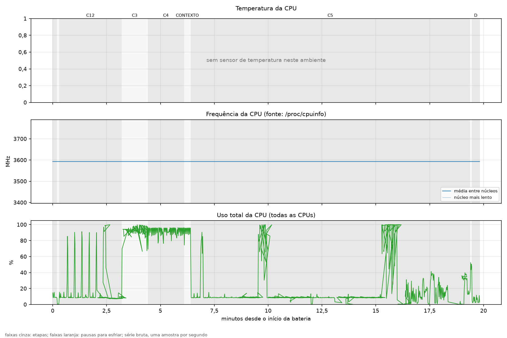

| Etapa | Duração (min) | Temp. média (°C) | Temp. máx. (°C) | Freq. média (MHz) | Freq. com CPU ocupada > 50% (MHz) | Uso médio da CPU (%) | Eventos de throttling |
|---|---|---|---|---|---|---|---|
| bateria inteira | 19,8 | — | — | 3.593 | 3.593 | 29,5 | n/d |
| PREPARO | 0,2 | — | — | 3.593 | — | 10,3 | n/d |
| AMBIENTE | 0,1 | — | — | 3.593 | — | 2,4 | n/d |
| C12 | 2,9 | — | — | 3.593 | 3.593 | 17,8 | n/d |
| C3 | 1,2 | — | — | 3.593 | 3.593 | 87,7 | n/d |
| C4 | 1,7 | — | — | 3.593 | 3.593 | 91,8 | n/d |
| CONTEXTO | 0,3 | — | — | 3.593 | 3.593 | 92,4 | n/d |
| C5 | 13,0 | — | — | 3.593 | 3.593 | 17,6 | n/d |
| C6 | 0,1 | — | — | 3.593 | 3.593 | 41,8 | n/d |
| D | 0,4 | — | — | 3.593 | — | 7,1 | n/d |


Contadores de throttling indisponíveis neste processador/ambiente (existem só em Intel). Sem sensor de temperatura exposto (comum em WSL e VMs); acompanhe pelo sistema hospedeiro. A frequência vem de /proc/cpuinfo; em VMs e no WSL costuma ser um valor fixo, não a real.


## C1/C2 — leitura convencional (read) vs mapeamento (mmap)

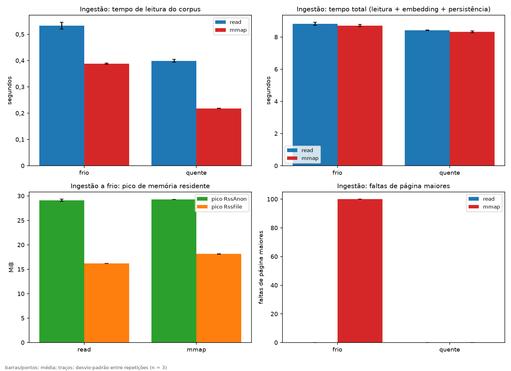

| Modo | Cache | Leitura (s) | Total (s) | Embedding (s) | Pico RssAnon (MiB) | Pico RssFile (MiB) | Faltas maiores | Faltas menores |
|---|---|---|---|---|---|---|---|---|
| read | frio | 0,533 ± 0,013 | 8,82 ± 0,09 | 7,85 ± 0,11 | 29,1 ± 0,2 | 16,2 ± 0,0 | 0 ± 0 | 726.525 ± 9 |
| read | quente | 0,399 ± 0,005 | 8,42 ± 0,02 | 7,60 ± 0,01 | 29,3 ± 0,0 | 16,2 ± 0,1 | 0 ± 0 | 726.125 ± 15 |
| mmap | frio | 0,388 ± 0,003 | 8,72 ± 0,06 | 7,91 ± 0,06 | 29,3 ± 0,0 | 18,1 ± 0,0 | 100 ± 0 | 729.636 ± 6 |
| mmap | quente | 0,218 ± 0,001 | 8,33 ± 0,05 | 7,70 ± 0,04 | 29,3 ± 0,1 | 18,1 ± 0,1 | 0 ± 0 | 729.351 ± 26 |


### Perfil de memória durante o chunking de um documento grande (tools.probe_rss)

Documento: `data/exp/corpus_200mb_2d/doc_00000.txt` (54614 chunks). Valores no último chunk, com a fonte ainda aberta (antes do munmap/close).


| Modo | Cache | RssAnon no fim (MiB) | RssFile no fim (MiB) | Δ RssAnon (MiB) | Δ RssFile (MiB) | Faltas maiores | Faltas menores |
|---|---|---|---|---|---|---|---|
| read | frio | 14,6 ± 0,0 | 14,4 ± 0,0 | 0,0 ± 0,0 | 0,0 ± 0,0 | 0 ± 0 | 1 ± 1 |
| read | quente | 14,6 ± 0,1 | 14,4 ± 0,0 | 0,0 ± 0,0 | 0,0 ± 0,0 | 0 ± 0 | 1 ± 1 |
| mmap | frio | 14,6 ± 0,0 | 114,4 ± 0,0 | 0,0 ± 0,0 | 100,0 ± 0,0 | 1 ± 0 | 454 ± 1 |
| mmap | quente | 14,6 ± 0,0 | 114,4 ± 0,0 | 0,0 ± 0,0 | 100,0 ± 0,0 | 0 ± 0 | 455 ± 1 |


### Consulta: releitura do corpus por read vs mmap (scripts.exp_consulta)

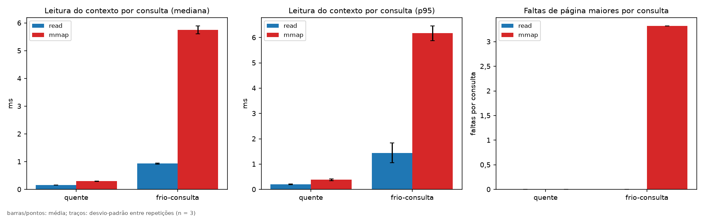

| Modo | Cache | Leitura mediana (ms) | Leitura p95 (ms) | Recuperação mediana (ms) | Recuperação p95 (ms) | Faltas maiores/consulta | Faltas menores/consulta |
|---|---|---|---|---|---|---|---|
| read | quente | 0,163 ± 0,000 | 0,206 ± 0,012 | 6,39 ± 0,02 | 6,97 ± 0,16 | 0,00 ± 0,00 | 177,23 ± 2,07 |
| read | frio-consulta | 0,932 ± 0,019 | 1,442 ± 0,389 | 7,22 ± 0,08 | 11,00 ± 4,80 | 0,00 ± 0,00 | 176,04 ± 0,00 |
| mmap | quente | 0,296 ± 0,008 | 0,382 ± 0,037 | 6,53 ± 0,05 | 6,99 ± 0,04 | 0,00 ± 0,00 | 180,13 ± 0,01 |
| mmap | frio-consulta | 5,755 ± 0,140 | 6,170 ± 0,289 | 12,12 ± 0,17 | 12,75 ± 0,34 | 3,32 ± 0,00 | 176,81 ± 0,03 |


`frio-consulta`: corpus despejado do page cache antes de cada consulta (vetores e SQLite quentes). Mesma semântica de `tools.bench_query`.


Conferência com `tools.bench_query` (ferramenta do núcleo citada no CLAUDE.md):


| Modo | Cache | Leitura mediana (ms) | Faltas maiores/consulta |
|---|---|---|---|
| read | frio | 0,908 ± 0,002 | 0,00 ± 0,00 |
| read | quente | 0,378 ± 0,374 | 0,00 ± 0,00 |
| mmap | frio | 6,859 ± 0,022 | 3,32 ± 0,00 |
| mmap | quente | 0,289 ± 0,005 | 0,00 ± 0,00 |


### Chamadas de sistema na ingestão (strace -c -f)

| Syscall | read (chamadas) | mmap (chamadas) |
|---|---|---|
| `read` | 109.637 | 337 |
| `lseek` | 109.612 | 312 |
| `brk` | 5.984 | 5.984 |
| `newfstatat` | 862 | 862 |
| `pwrite64` | 840 | 840 |
| `fstat` | 585 | 685 |
| `write` | 430 | 430 |
| `close` | 324 | 424 |
| `openat` | 335 | 335 |
| `mmap` | 175 | 274 |
| `ioctl` | 183 | 183 |
| `fcntl` | 55 | 155 |


Execução separada sob strace; seus tempos não entram nas tabelas acima.


## C3 — concorrência e fila (2 produtores, fila de capacidade 4)

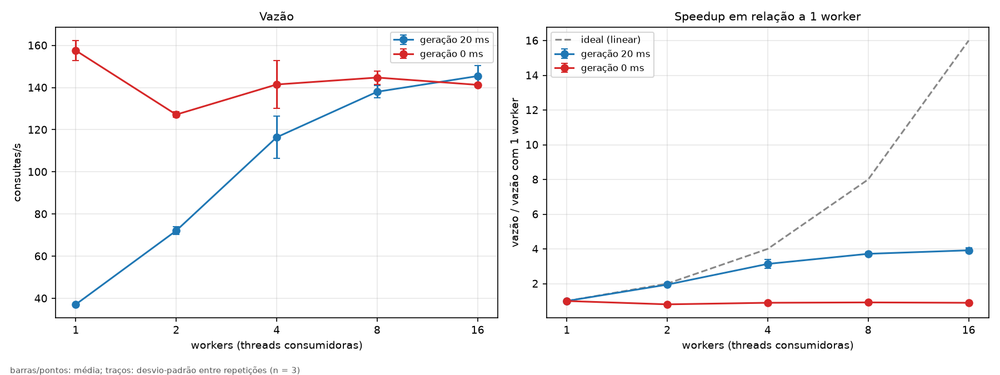

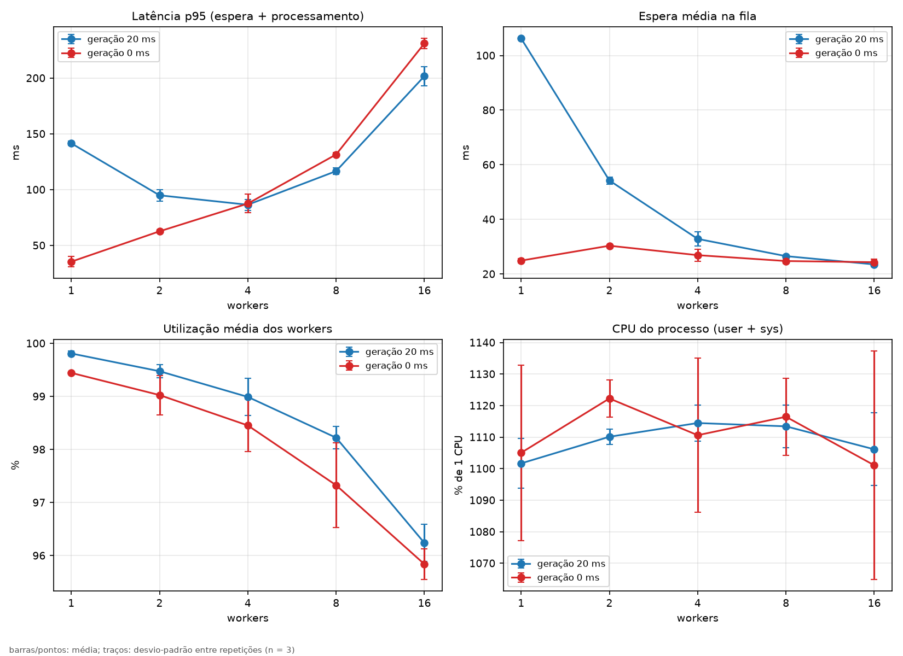


**geração 20 ms**


| Workers | Vazão (req/s) | Latência mediana (ms) | Latência p95 (ms) | Processamento mediano (ms) | Espera média (ms) | Fila média | Fila máx. | Utilização (%) | CPU (%) | Bloqueio dos produtores (s) | Threads | Pico RSS (MiB) | Desbalanceamento entre workers (%) |
|---|---|---|---|---|---|---|---|---|---|---|---|---|---|
| 1 | 37,1 ± 0,0 | 133,4 ± 0,3 | 141,6 ± 1,9 | 26,6 ± 0,1 | 106,3 ± 0,0 | 3,97 ± 0,00 | 4 ± 0 | 99,8 ± 0,0 | 1.101,7 ± 7,8 | 10,43 ± 0,00 | 12 ± 0 | 247,2 ± 0,1 | 0,0 ± 0,0 |
| 2 | 72,1 ± 1,9 | 79,6 ± 0,4 | 94,9 ± 5,2 | 26,5 ± 0,1 | 54,2 ± 1,3 | 3,96 ± 0,00 | 4 ± 0 | 99,5 ± 0,1 | 1.110,1 ± 2,5 | 5,30 ± 0,14 | 12 ± 0 | 248,4 ± 0,1 | 0,0 ± 0,0 |
| 4 | 116,4 ± 9,9 | 65,3 ± 6,5 | 86,5 ± 4,9 | 32,6 ± 3,9 | 32,9 ± 2,6 | 3,93 ± 0,02 | 4 ± 0 | 99,0 ± 0,4 | 1.114,5 ± 5,7 | 3,24 ± 0,24 | 12 ± 1 | 251,0 ± 0,1 | 1,3 ± 0,6 |
| 8 | 138,0 ± 2,8 | 80,4 ± 1,1 | 116,6 ± 2,7 | 54,3 ± 1,5 | 26,6 ± 0,3 | 3,80 ± 0,02 | 4 ± 0 | 98,2 ± 0,2 | 1.113,4 ± 6,8 | 2,69 ± 0,03 | 12 ± 0 | 256,0 ± 0,1 | 2,0 ± 0,5 |
| 16 | 145,4 ± 5,0 | 127,8 ± 4,5 | 201,7 ± 8,5 | 101,3 ± 2,5 | 23,5 ± 0,9 | 3,60 ± 0,04 | 4 ± 0 | 96,2 ± 0,3 | 1.106,1 ± 11,5 | 2,42 ± 0,15 | 12 ± 0 | 265,3 ± 0,1 | 1,7 ± 0,3 |


**geração 0 ms**


| Workers | Vazão (req/s) | Latência mediana (ms) | Latência p95 (ms) | Processamento mediano (ms) | Espera média (ms) | Fila média | Fila máx. | Utilização (%) | CPU (%) | Bloqueio dos produtores (s) | Threads | Pico RSS (MiB) | Desbalanceamento entre workers (%) |
|---|---|---|---|---|---|---|---|---|---|---|---|---|---|
| 1 | 157,6 ± 4,7 | 30,8 ± 0,2 | 35,4 ± 4,7 | 6,2 ± 0,1 | 24,9 ± 0,8 | 3,97 ± 0,00 | 4 ± 0 | 99,4 ± 0,0 | 1.105,0 ± 27,8 | 2,46 ± 0,08 | 12 ± 0 | 247,1 ± 0,0 | 0,0 ± 0,0 |
| 2 | 127,2 ± 1,3 | 43,4 ± 0,7 | 62,7 ± 1,5 | 13,3 ± 0,6 | 30,4 ± 0,2 | 3,93 ± 0,01 | 4 ± 0 | 99,0 ± 0,4 | 1.122,3 ± 5,8 | 2,93 ± 0,03 | 12 ± 0 | 248,4 ± 0,1 | 15,3 ± 4,5 |
| 4 | 141,5 ± 11,4 | 52,0 ± 4,6 | 87,5 ± 8,3 | 25,5 ± 2,5 | 26,9 ± 2,2 | 3,91 ± 0,03 | 4 ± 0 | 98,5 ± 0,5 | 1.110,6 ± 24,5 | 2,67 ± 0,21 | 12 ± 0 | 251,0 ± 0,0 | 5,5 ± 3,3 |
| 8 | 144,7 ± 3,2 | 75,0 ± 2,5 | 131,5 ± 1,8 | 48,8 ± 0,9 | 24,8 ± 0,9 | 3,73 ± 0,08 | 4 ± 0 | 97,3 ± 0,8 | 1.116,5 ± 12,2 | 2,51 ± 0,14 | 12 ± 0 | 256,0 ± 0,1 | 4,3 ± 1,0 |
| 16 | 141,3 ± 0,6 | 133,2 ± 6,1 | 231,1 ± 4,5 | 104,7 ± 5,1 | 24,3 ± 1,1 | 3,67 ± 0,18 | 4 ± 0 | 95,8 ± 0,3 | 1.101,1 ± 36,2 | 2,53 ± 0,15 | 12 ± 0 | 265,3 ± 0,0 | 3,5 ± 1,0 |


Desbalanceamento = (máx − mín de consultas atendidas por worker) / total. Valores altos indicam workers ociosos ou starvation. Threads = threads do processo ao final da execução, depois que os workers terminaram; inclui threads criadas por bibliotecas (o numpy usa um pool próprio de threads do BLAS). CPU (%) é relativa a 1 CPU e inclui o tempo dessas threads de biblioteca.


### Evidência de threads (servidor com 4 workers e 2 produtores, /proc/PID/task)

Colunas: TID, comando, estado, função do kernel em que a thread espera (wchan).


```
7171 python S (sleeping) futex_do_wait
7173 python R (running) 0
7174 python R (running) 0
7175 python R (running) 0
7176 python R (running) 0
7177 python R (running) 0
7178 python R (running) 0
7179 python R (running) 0
7180 python R (running) 0
7181 python R (running) 0
7182 python R (running) 0
7183 python R (running) 0
7184 python R (running) 0
7185 python R (running) futex_do_wait
7186 python S (sleeping) 0
7187 python S (sleeping) hrtimer_nanosleep
7188 python S (sleeping) futex_do_wait
7189 python S (sleeping) futex_do_wait
```


### Chamadas de sistema do servidor (strace -c -f, 4 workers)

| Syscall | Chamadas |
|---|---|
| `futex` | 10.993 |
| `fstat` | 1.978 |
| `newfstatat` | 1.223 |
| `read` | 1.189 |
| `lseek` | 1.162 |
| `openat` | 923 |
| `close` | 913 |
| `fcntl` | 588 |
| `pread64` | 418 |
| `clock_nanosleep` | 200 |


## C4 — cache compartilhado

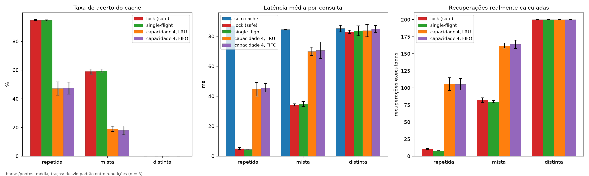

| Configuração | Carga | Acerto (%) | Acertos | Erros | Substituições | Cálculos | Coalescidas | Tempo economizado (s) | Espera no lock (ms) | Latência média (ms) | Latência p95 (ms) | Vazão (req/s) | Linhas de log corrompidas |
|---|---|---|---|---|---|---|---|---|---|---|---|---|---|
| sem cache | repetida | — | — | — | — | — | — | — | — | 87,1 ± 4,0 | 101,6 ± 3,7 | 67,7 ± 3,2 | — |
| sem cache | mista | — | — | — | — | — | — | — | — | 84,6 ± 0,2 | 99,8 ± 1,2 | 69,8 ± 0,1 | — |
| sem cache | distinta | — | — | — | — | — | — | — | — | 85,3 ± 2,2 | 100,4 ± 2,5 | 69,3 ± 1,8 | — |
| lock (safe) | repetida | 94,8 ± 0,3 | 189,7 ± 0,6 | 10,3 ± 0,6 | 0,0 ± 0,0 | 10,3 ± 0,6 | 0,0 ± 0,0 | 6,18 ± 0,72 | 0,08 ± 0,02 | 5,1 ± 0,6 | 33,3 ± 5,4 | 1.144,5 ± 149,1 | 0 ± 0 |
| lock (safe) | mista | 59,0 ± 1,7 | 118,0 ± 3,5 | 82,0 ± 3,5 | 63,7 ± 2,1 | 82,0 ± 3,5 | 0,0 ± 0,0 | 3,67 ± 0,22 | 0,23 ± 0,02 | 34,3 ± 0,7 | 69,0 ± 0,9 | 170,2 ± 3,5 | 0 ± 0 |
| lock (safe) | distinta | 0,0 ± 0,0 | 0,0 ± 0,0 | 200,0 ± 0,0 | 184,0 ± 0,0 | 200,0 ± 0,0 | 0,0 ± 0,0 | 0,00 ± 0,00 | 0,44 ± 0,08 | 83,0 ± 1,0 | 97,5 ± 3,5 | 71,1 ± 1,1 | 0 ± 0 |
| single-flight | repetida | 94,7 ± 0,3 | 189,3 ± 0,6 | 10,7 ± 0,6 | 0,0 ± 0,0 | 8,0 ± 0,0 | 2,7 ± 0,6 | 6,18 ± 0,24 | 0,07 ± 0,01 | 4,5 ± 0,3 | 34,5 ± 1,3 | 1.263,8 ± 75,1 | — |
| single-flight | mista | 59,7 ± 1,0 | 119,3 ± 2,1 | 80,7 ± 2,1 | 64,0 ± 1,7 | 80,0 ± 1,7 | 0,7 ± 0,6 | 3,86 ± 0,22 | 0,25 ± 0,07 | 34,8 ± 1,8 | 72,3 ± 1,0 | 166,5 ± 9,5 | — |
| single-flight | distinta | 0,0 ± 0,0 | 0,0 ± 0,0 | 200,0 ± 0,0 | 184,0 ± 0,0 | 200,0 ± 0,0 | 0,0 ± 0,0 | 0,00 ± 0,00 | 0,48 ± 0,11 | 83,7 ± 3,4 | 96,7 ± 11,6 | 70,6 ± 3,0 | — |
| capacidade 4, LRU | repetida | 47,2 ± 4,6 | 94,3 ± 9,3 | 105,7 ± 9,3 | 84,0 ± 7,8 | 105,7 ± 9,3 | 0,0 ± 0,0 | 2,68 ± 0,24 | 0,29 ± 0,04 | 44,7 ± 4,6 | 79,6 ± 4,2 | 132,4 ± 13,1 | — |
| capacidade 4, LRU | mista | 19,0 ± 1,8 | 38,0 ± 3,6 | 162,0 ± 3,6 | 149,0 ± 2,6 | 162,0 ± 3,6 | 0,0 ± 0,0 | 1,13 ± 0,18 | 0,38 ± 0,07 | 70,0 ± 2,8 | 95,9 ± 7,9 | 83,9 ± 3,4 | — |
| capacidade 4, LRU | distinta | 0,0 ± 0,0 | 0,0 ± 0,0 | 200,0 ± 0,0 | 196,0 ± 0,0 | 200,0 ± 0,0 | 0,0 ± 0,0 | 0,00 ± 0,00 | 0,43 ± 0,11 | 83,9 ± 4,1 | 96,4 ± 8,4 | 70,5 ± 3,4 | — |
| capacidade 4, FIFO | repetida | 47,3 ± 4,2 | 94,7 ± 8,4 | 105,3 ± 8,4 | 83,7 ± 7,5 | 105,3 ± 8,4 | 0,0 ± 0,0 | 2,81 ± 0,27 | 0,28 ± 0,04 | 45,7 ± 2,8 | 79,4 ± 4,1 | 128,8 ± 7,6 | — |
| capacidade 4, FIFO | mista | 18,0 ± 3,0 | 36,0 ± 6,1 | 164,0 ± 6,1 | 150,3 ± 3,1 | 164,0 ± 6,1 | 0,0 ± 0,0 | 1,03 ± 0,14 | 0,46 ± 0,11 | 70,7 ± 5,5 | 95,3 ± 7,7 | 83,7 ± 6,7 | — |
| capacidade 4, FIFO | distinta | 0,0 ± 0,0 | 0,0 ± 0,0 | 200,0 ± 0,0 | 196,0 ± 0,0 | 200,0 ± 0,0 | 0,0 ± 0,0 | 0,00 ± 0,00 | 0,50 ± 0,02 | 84,9 ± 2,2 | 101,0 ± 3,2 | 69,5 ± 1,8 | — |


Carga `repetida`: consultas de um conjunto fixo (parâmetro `--cache-distinct` do benchmark, padrão 8). Com capacidade ≥ esse número, cada chave deveria ser calculada uma vez; cálculos acima disso na configuração `lock (safe)` são recálculos concorrentes da mesma chave (dois workers erram ao mesmo tempo), que o `single-flight` elimina (coluna Coalescidas).


## Fator contexto (max_context_bytes 2048 vs 8192)

| Contexto (bytes) | Latência mediana (ms) | Latência p95 (ms) | Vazão (req/s) | Pico RSS (MiB) | Faltas menores |
|---|---|---|---|---|---|
| 2048 | 81,53 ± 3,58 | 97,78 ± 4,38 | 70,6 ± 2,8 | 248,4 ± 0,1 | 7.104 ± 110 |
| 8192 | 79,81 ± 0,31 | 96,52 ± 1,13 | 72,3 ± 0,5 | 248,4 ± 0,1 | 7.039 ± 13 |


## C5 — pressão de memória: tamanho do corpus e índice em RAM vs mmap


### Ingestão por tamanho de corpus (cache frio)

| Corpus (MiB) | Índice (MiB) | Tempo total (s) | Leitura (s) | Pico RssAnon (MiB) | Pico RssFile (MiB) |
|---|---|---|---|---|---|
| 200 | 216,5 ± 0,0 | 8,75 ± 0,06 | 0,57 ± 0,02 | 29,3 ± 0,0 | 16,2 ± 0,0 |
| 1000 | 1.082,2 ± 0,0 | 45,04 ± 1,41 | 2,44 ± 0,11 | 29,3 ± 0,0 | 16,2 ± 0,0 |
| 2000 | 2.164,5 ± 0,0 | 92,39 ± 6,17 | 6,95 ± 2,45 | 29,4 ± 0,0 | 16,2 ± 0,0 |

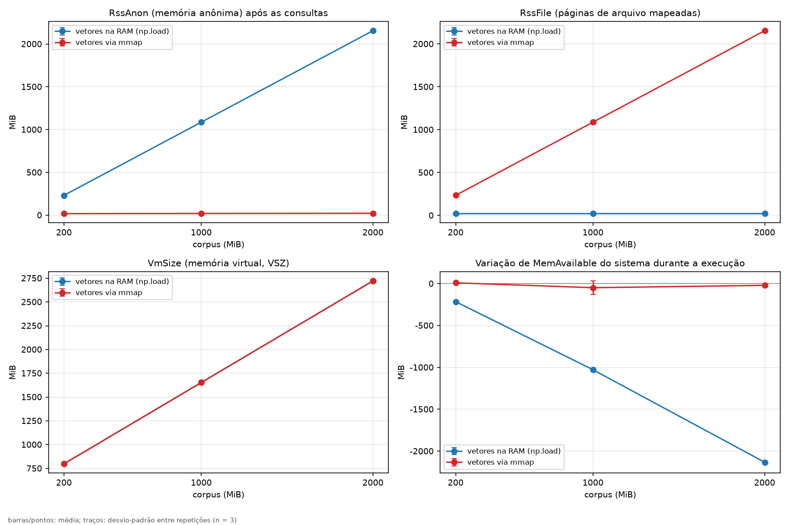

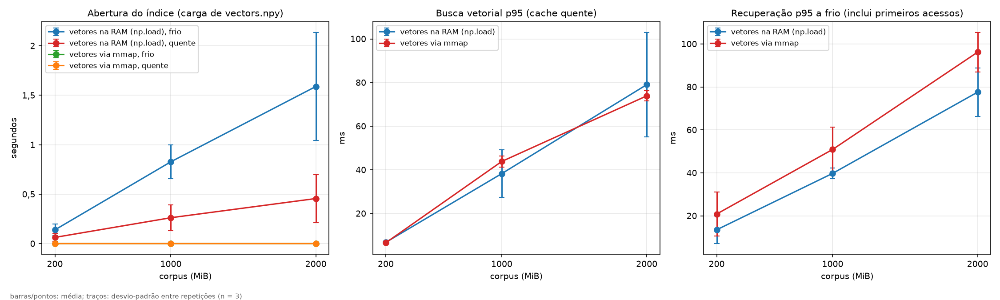


### Consultas por tamanho de corpus

| Corpus (MiB) | Vetores | Cache | Abertura (s) | RssAnon (MiB) | RssFile (MiB) | VSZ (MiB) | Pico RSS (MiB) | Busca mediana (ms) | Busca p95 (ms) | Recuperação p95 (ms) | Faltas maiores/consulta | Δ MemAvailable (MiB) | Swap em uso (MiB) |
|---|---|---|---|---|---|---|---|---|---|---|---|---|---|
| 200 | vetores na RAM (np.load) | frio | 0,139 ± 0,059 | 232,0 ± 0,0 | 21,0 ± 0,0 | 798,3 ± 0,0 | 253,0 ± 0,0 | 6,67 ± 1,09 | 8,26 ± 2,46 | 13,49 ± 6,43 | 0,00 ± 0,00 | -215,3 ± 0,8 | 0,0 ± 0,0 |
| 200 | vetores na RAM (np.load) | quente | 0,063 ± 0,040 | 231,6 ± 0,0 | 21,0 ± 0,1 | 797,7 ± 0,0 | 252,8 ± 0,1 | 6,11 ± 0,16 | 6,79 ± 0,37 | 7,24 ± 0,34 | 0,00 ± 0,00 | -215,6 ± 6,7 | 0,0 ± 0,0 |
| 200 | vetores via mmap | frio | 0,001 ± 0,000 | 18,5 ± 0,0 | 234,5 ± 0,1 | 798,2 ± 0,0 | 253,0 ± 0,1 | 6,18 ± 0,05 | 9,65 ± 2,17 | 20,83 ± 10,26 | 0,37 ± 0,00 | 23,2 ± 11,0 | 0,0 ± 0,0 |
| 200 | vetores via mmap | quente | 0,001 ± 0,000 | 18,1 ± 0,0 | 234,5 ± 0,0 | 797,7 ± 0,0 | 252,6 ± 0,0 | 6,15 ± 0,03 | 6,60 ± 0,39 | 7,00 ± 0,38 | 0,00 ± 0,00 | 9,1 ± 18,5 | 0,0 ± 0,0 |
| 1000 | vetores na RAM (np.load) | frio | 0,828 ± 0,171 | 1.088,8 ± 0,1 | 21,0 ± 0,1 | 1.654,9 ± 0,1 | 1.109,8 ± 0,0 | 30,95 ± 1,88 | 35,17 ± 2,67 | 39,75 ± 2,46 | 0,00 ± 0,00 | -1.069,2 ± 18,4 | 0,0 ± 0,0 |
| 1000 | vetores na RAM (np.load) | quente | 0,262 ± 0,131 | 1.086,7 ± 0,0 | 21,0 ± 0,0 | 1.652,8 ± 0,0 | 1.111,3 ± 0,1 | 30,99 ± 0,23 | 38,28 ± 10,86 | 38,79 ± 10,84 | 0,00 ± 0,00 | -1.028,3 ± 6,1 | 0,0 ± 0,0 |
| 1000 | vetores via mmap | frio | 0,001 ± 0,000 | 22,0 ± 0,0 | 1.087,8 ± 0,0 | 1.654,9 ± 0,0 | 1.109,8 ± 0,0 | 31,98 ± 1,22 | 37,08 ± 0,75 | 50,90 ± 10,43 | 0,37 ± 0,00 | 46,2 ± 41,2 | 0,0 ± 0,0 |
| 1000 | vetores via mmap | quente | 0,001 ± 0,000 | 19,9 ± 0,0 | 1.087,8 ± 0,1 | 1.652,8 ± 0,0 | 1.111,1 ± 0,1 | 34,04 ± 2,07 | 43,85 ± 2,51 | 44,37 ± 2,51 | 0,00 ± 0,00 | -49,1 ± 81,4 | 0,0 ± 0,0 |
| 2000 | vetores na RAM (np.load) | frio | 1,589 ± 0,546 | 2.159,6 ± 0,0 | 21,1 ± 0,0 | 2.725,7 ± 0,0 | 2.180,7 ± 0,0 | 60,65 ± 2,87 | 70,98 ± 8,02 | 77,57 ± 11,26 | 0,00 ± 0,00 | -2.139,2 ± 12,5 | 0,0 ± 0,0 |
| 2000 | vetores na RAM (np.load) | quente | 0,456 ± 0,242 | 2.155,4 ± 0,0 | 20,9 ± 0,0 | 2.721,5 ± 0,0 | 2.184,1 ± 0,1 | 60,65 ± 0,24 | 79,04 ± 23,91 | 79,53 ± 23,93 | 0,00 ± 0,00 | -2.132,2 ± 18,8 | 0,0 ± 0,0 |
| 2000 | vetores via mmap | frio | 0,001 ± 0,000 | 26,2 ± 0,0 | 2.154,4 ± 0,1 | 2.725,7 ± 0,0 | 2.180,6 ± 0,1 | 64,14 ± 2,65 | 82,29 ± 12,57 | 96,18 ± 9,17 | 0,37 ± 0,00 | -7,0 ± 43,8 | 0,0 ± 0,0 |
| 2000 | vetores via mmap | quente | 0,001 ± 0,000 | 22,0 ± 0,0 | 2.154,3 ± 0,0 | 2.721,5 ± 0,0 | 2.183,8 ± 0,1 | 63,77 ± 1,79 | 73,90 ± 2,36 | 74,42 ± 2,42 | 0,00 ± 0,00 | -20,8 ± 7,2 | 0,0 ± 0,0 |


Mapeamento do `vectors.npy` em `/proc/self/smaps` (vetores via mmap, `smaps_200mb_vm1.txt`):


```
# trechos de /proc/self/smaps (mapeamentos do índice e do corpus)
7fbb07800000-7fbb14d7b000 r--s 00000000 08:30 192323                     /home/anderson/SO/genresearch-servidor/data/exp/c5_store_200mb/vectors.npy
Size:             218604 kB
Rss:              218604 kB
Pss:              218604 kB
Shared_Clean:          0 kB
Private_Clean:    218604 kB
Anonymous:             0 kB
Swap:                  0 kB
```


### Execução com limite de memória sobre o maior índice

Índice de 2000 MiB de corpus; mecanismo `systemd` (`systemd` = cgroup MemoryMax, pode paginar/usar swap; `rlimit` = RLIMIT_AS, só falha por falta de espaço de endereçamento).


| Rep | Vetores | Mecanismo | Limite | Saída | Duração (s) | Consultas ok | Abertura (s) | Recuperação mediana (ms) | Faltas maiores/consulta | VmSwap (MiB) | Erro |
|---|---|---|---|---|---|---|---|---|---|---|---|
| 1 | RAM (np.load) | systemd | 1220 MiB | 0 — concluiu | 79 | 10 | 22,98 | 5.048,1 | 67.715,4 | 971,4 |  |
| 1 | mmap | systemd | 1220 MiB | 0 — concluiu | 6 | 10 | 0,00 | 580,6 | 18,8 | 0,0 |  |
| 2 | RAM (np.load) | systemd | 1220 MiB | 0 — concluiu | 49 | 10 | 6,07 | 2.625,5 | 88.715,8 | 969,3 |  |
| 2 | mmap | systemd | 1220 MiB | 0 — concluiu | 7 | 10 | 0,00 | 635,1 | 17,3 | 0,0 |  |
| 3 | RAM (np.load) | systemd | 1220 MiB | 0 — concluiu | 55 | 10 | 30,08 | 2.407,5 | 91.885,7 | 951,9 |  |
| 3 | mmap | systemd | 1220 MiB | 0 — concluiu | 8 | 10 | 0,01 | 783,4 | 13,0 | 0,0 |  |

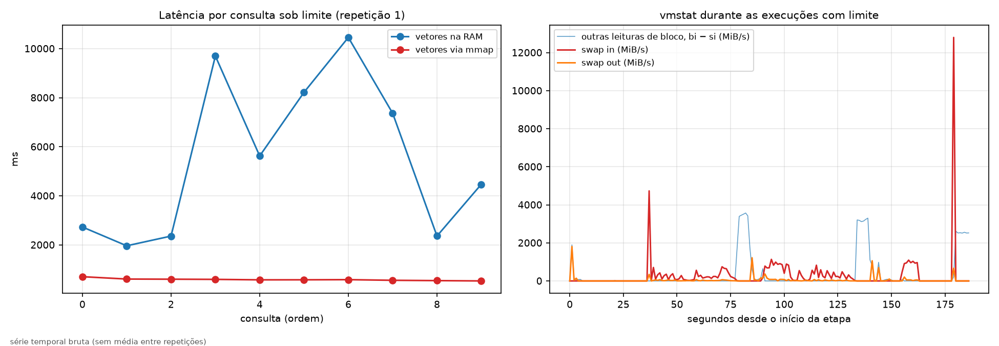


Soma bruta das amostras do vmstat durante as execuções com limite (187 s): 51,6 GiB de swap-in e 9,6 GiB de swap-out (maior amostra de swap-in: 12.799 MiB/s). Amostras isoladas muito acima das vizinhas devem ser tratadas com cautela; os campos por processo (VmSwap e faltas maiores) são a evidência mais direta.


## C6 — falhas controladas

Fila saturada: 1 worker, fila de capacidade 1, timeout de inserção 0.001 s, geração simulada 100 ms.


| Configuração | Consultas | Processadas | Rejeitadas (fila cheia) | Erros | Vazão (req/s) | Bloqueio dos produtores (s) | Fila máx. |
|---|---|---|---|---|---|---|---|
| C6_fila_saturada | 40 ± 0 | 2,0 ± 0,0 | 38,0 ± 0,0 | 0 ± 0 | 8,67 ± 0,46 | 0,058 ± 0,009 | 1 ± 0 |


Falhas de armazenamento (`python -m genresearch query` sobre stores preparados):


| Caso | Repetições | Códigos de saída | Mensagem (última linha do stderr) |
|---|---|---|---|
| store_inexistente | 3 | 1 | `FileNotFoundError: store não encontrado: data/exp/falhas/nao_existe/meta.sqlite` |
| corpus_ausente | 3 | 1 | `FileNotFoundError: corpus do store ausente: data/exp/falhas/store_corpus_apagado/../corpus_apagado (o store não guarda texto)` |
| indice_indisponivel | 3 | 1 | `FileNotFoundError: [Errno 2] No such file or directory: 'data/exp/falhas/store_sem_vetores/vectors.npy'` |
| corpus_alterado | 3 | 1 | `RuntimeError: doc_00001.txt: tamanho 524302 difere do ingerido (524288); corpus alterado` |


A falha por limite de memória está na seção C5 (execução com limite).


## Parte D — sincronização: falha demonstrada sem proteção e corrigida

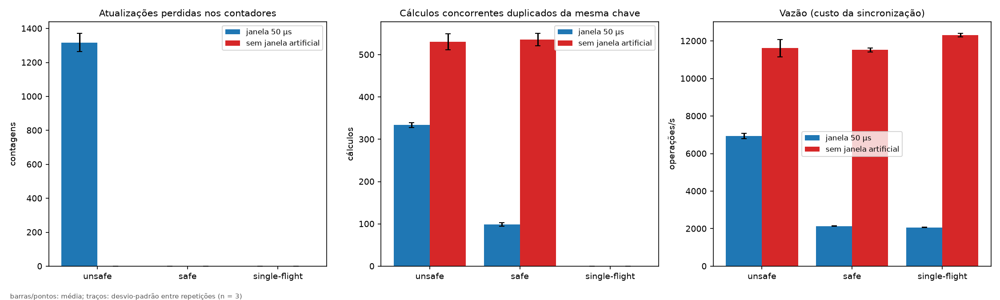

Cache: 8 threads × 500 operações, 40 chaves, capacidade 16, cálculo de 1.0 ms. A "verdade" é contada fora do cache pelo harness (`tools.sync_demo`).


| Modo | Janela | Atualizações perdidas | Estouro de capacidade | Tamanho máx. observado | Cálculos reportados − reais | Cálculos duplicados | Coalescidas | Exceções internas | Espera no lock (s) | Vazão (op/s) |
|---|---|---|---|---|---|---|---|---|---|---|
| unsafe | janela 50 µs | 1.317,0 ± 53,4 | 3,0 ± 0,0 | 19,0 ± 0,0 | -824,0 ± 24,1 | 333,7 ± 6,0 | 0,0 ± 0,0 | 41,0 ± 7,0 | 0,00 ± 0,00 | 6.931 ± 144 |
| unsafe | sem janela artificial | 0,0 ± 0,0 | 0,0 ± 0,0 | 16,0 ± 0,0 | 0,0 ± 0,0 | 530,3 ± 18,8 | 0,0 ± 0,0 | 0,0 ± 0,0 | 0,00 ± 0,00 | 11.620 ± 460 |
| safe | janela 50 µs | 0,0 ± 0,0 | 0,0 ± 0,0 | 16,0 ± 0,0 | 0,0 ± 0,0 | 99,0 ± 4,4 | 0,0 ± 0,0 | 0,0 ± 0,0 | 10,19 ± 0,12 | 2.135 ± 16 |
| safe | sem janela artificial | 0,0 ± 0,0 | 0,0 ± 0,0 | 16,0 ± 0,0 | 0,0 ± 0,0 | 535,3 ± 14,6 | 0,0 ± 0,0 | 0,0 ± 0,0 | 0,00 ± 0,00 | 11.520 ± 112 |
| single-flight | janela 50 µs | 0,0 ± 0,0 | 0,0 ± 0,0 | 16,0 ± 0,0 | 0,0 ± 0,0 | 0,0 ± 0,0 | 404,3 ± 12,1 | 0,0 ± 0,0 | 9,93 ± 0,09 | 2.069 ± 4 |
| single-flight | sem janela artificial | 0,0 ± 0,0 | 0,0 ± 0,0 | 16,0 ± 0,0 | 0,0 ± 0,0 | 0,0 ± 0,0 | 554,3 ± 26,6 | 0,0 ± 0,0 | 0,00 ± 0,00 | 12.304 ± 92 |

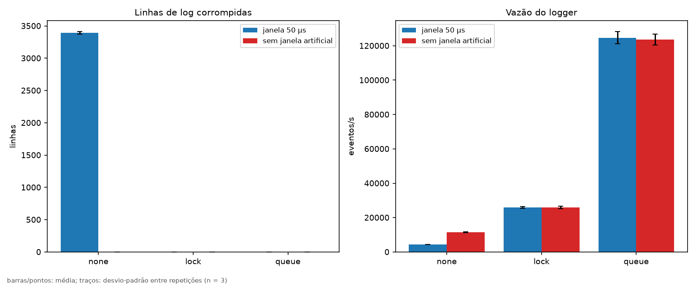

| Modo | Janela | Esperadas | Válidas | Corrompidas | Perdidas | Fora de ordem | Espera no lock (ms) | Fila máx. | Vazão (eventos/s) |
|---|---|---|---|---|---|---|---|---|---|
| none | janela 50 µs | 4.000 ± 0 | 607,0 ± 17,3 | 3.393,0 ± 17,3 | 3.393,0 ± 17,3 | 28,3 ± 3,8 | 0,00 ± 0,00 | 0 ± 0 | 4.454 ± 29 |
| none | sem janela artificial | 4.000 ± 0 | 4.000,0 ± 0,0 | 0,0 ± 0,0 | 0,0 ± 0,0 | 118,7 ± 26,8 | 0,00 ± 0,00 | 0 ± 0 | 11.518 ± 235 |
| lock | janela 50 µs | 4.000 ± 0 | 4.000,0 ± 0,0 | 0,0 ± 0,0 | 0,0 ± 0,0 | 0,0 ± 0,0 | 877,78 ± 20,92 | 0 ± 0 | 26.040 ± 478 |
| lock | sem janela artificial | 4.000 ± 0 | 4.000,0 ± 0,0 | 0,0 ± 0,0 | 0,0 ± 0,0 | 0,0 ± 0,0 | 884,56 ± 44,39 | 0 ± 0 | 25.947 ± 803 |
| queue | janela 50 µs | 4.000 ± 0 | 4.000,0 ± 0,0 | 0,0 ± 0,0 | 0,0 ± 0,0 | 0,0 ± 0,0 | 0,00 ± 0,00 | 4.000 ± 0 | 124.726 ± 3.450 |
| queue | sem janela artificial | 4.000 ± 0 | 4.000,0 ± 0,0 | 0,0 ± 0,0 | 0,0 ± 0,0 | 0,0 ± 0,0 | 0,00 ± 0,00 | 4.000 ± 1 | 123.642 ± 3.077 |


Exemplo de linhas corrompidas (`parte_d/logs/log_none_janela50_rep1.jsonl`):


```
{"seq":0,"t":0.001753,{"seq":1,"t":0.001852,{"seq":2,"t":0.001912,{"seq":3,"t":0.001974,{"seq":4,"t":0.002034,
"campos":{"worker":0,"i":0}}
"evento":"consulta","evento":"consulta","campos":{"worker":1,"i":0}}
"campos":{"worker":5,"i":0}}
```


A janela de 50 µs é artificial (`--window-us`): amplia o intervalo entre leitura e escrita para tornar a corrida reprodutível e deve ser declarada no relatório. As linhas "sem janela artificial" mostram o comportamento natural no CPython.


## Mapa das questões de análise (seção 11) para as evidências

| Questão | Onde está a evidência nesta execução |
|---|---|
| Como tamanho de corpus, índice, lote ou contexto afetou RAM, paginação e latência? | C5 (`c5_memoria`, `c5_latencia`, tabelas de C5) e fator contexto |
| Que diferença foi observada entre leitura convencional e mmap? | C1/C2 (`c12_ingestao`, `c12_consulta`, perfil de RSS, strace) e vetores RAM × mmap no C5 |
| O cache reduziu tempo ou operações de recuperação? Qual foi a taxa de acerto? | C4 (`c4_cache`, colunas Acerto, Cálculos e Tempo economizado) |
| A concorrência aumentou vazão? Em que ponto gerou contenção, fila ou degradação? | C3 (`c3_vazao` contra a reta ideal, `c3_latencia_recursos`, espera e fila) |
| Que recurso compartilhado exigiu exclusão mútua ou sincronização de eventos? | Parte D (cache e log), fila do C3 (bloqueio dos produtores, futex no strace) |
| Que condição de corrida, risco de deadlock, starvation ou falha de consistência foi demonstrada? | Parte D (`d_cache`, `d_log`), C4 (cálculos duplicados) e desbalanceamento entre workers no C3 |
| Qual mecanismo de sincronização foi adotado e quais trade-offs introduziu? | Parte D: vazão e espera no lock de unsafe × safe × single-flight; none × lock × queue |
| Houve evidência de paginação intensa, swap, faltas de página ou pressão de memória? | C5 (execução com limite, `c5_limite`, vmstat, faltas maiores) e C1/C2 a frio |
| Como os resultados se relacionam a RAG, embeddings, checkpoints e caches? | Abertura do índice frio × quente no C5 (análogo a carregar checkpoint), C4, C1/C2 |
| Quais limitações impedem generalizar para modelos maiores, múltiplas GPUs ou ambientes distribuídos? | Ambiente (uma máquina, sem GPU), condições térmicas, geração simulada, embeddings por hashing, mecanismo de limite usado |

